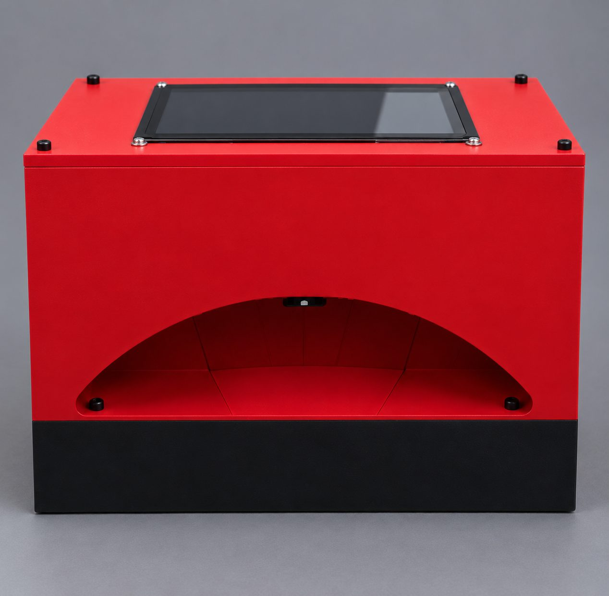
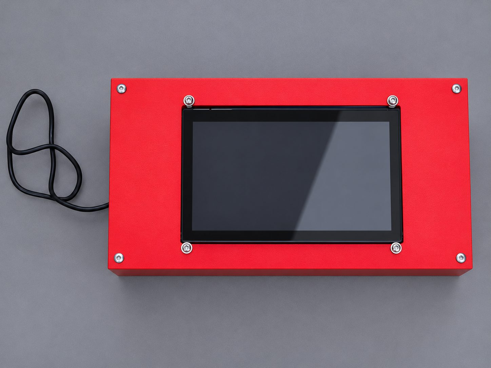
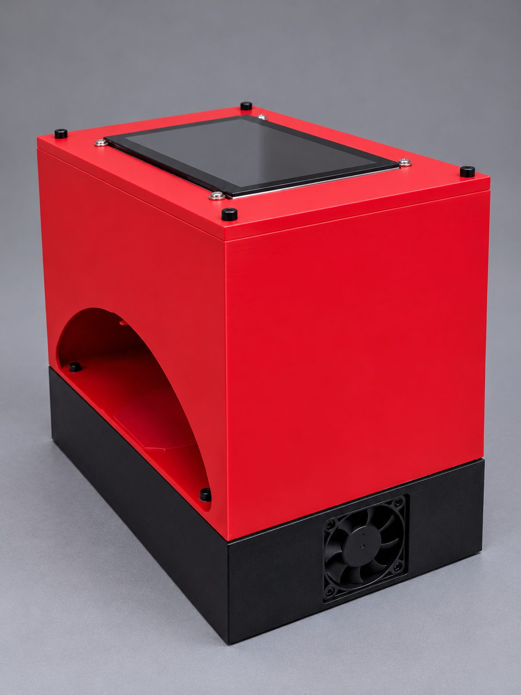
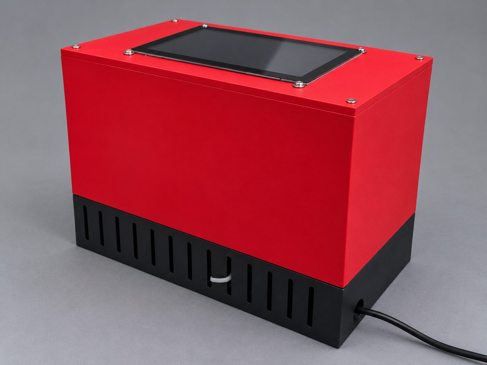
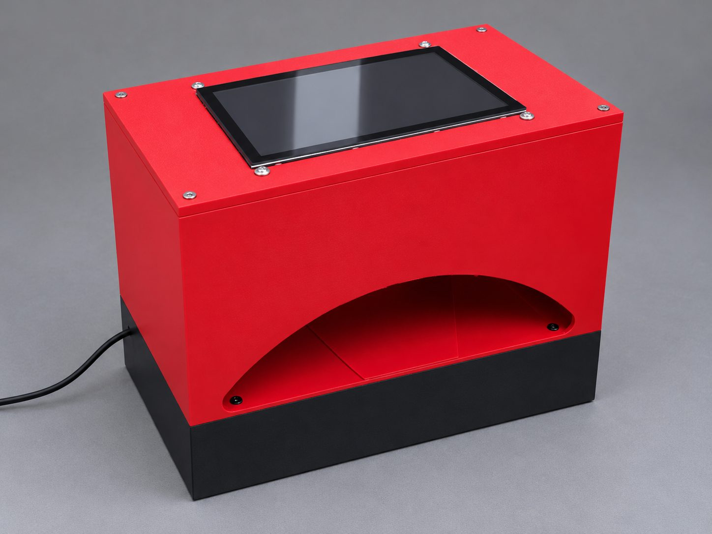

# RaktSetu: evidence and proof of work

One place to check what was built, when, and what it does. Every claim below points to a file in this repository or to its commit history.

---

## 1. The device exists

| Evidence | Where |
|---|---|
| Five photos of the working prototype (front, top, open chamber, vents, fan) | [`dashboard/`](dashboard/) |
| Device software that runs the hardware end to end | [`device/`](device/) |
| One-command Raspberry Pi 5 installer | [`device/install.sh`](device/install.sh) |
| Step-by-step setup guide for a non-technical operator | [`docs/RaktSetu_Pi_Setup.txt`](docs/RaktSetu_Pi_Setup.txt) |

    

**Hardware**

| Part | Role |
|---|---|
| Raspberry Pi 5 + touchscreen | runs the model and interface fully offline |
| USB webcam (Lenovo), colour settings locked | captures the nail bed |
| Light-sealed finger chamber (CAD-designed, printed) | blocks ambient light, fixes finger and camera position, fixed internal illumination |
| MAX30102 red/IR sensor | captured red and infrared readings on the bench prototype; logged for Version 2 |

---

## 2. The model works, and the numbers are reproducible

Model: EfficientNet-B0, ImageNet-pretrained, fine-tuned and exported to TensorFlow Lite.
Source of truth: [`device/models/model_config.json`](device/models/model_config.json), written by the training notebook.

**Held-out test set, 485 images never seen in training**

| Model | AUC | Accuracy | Sensitivity | Specificity |
|---|---|---|---|---|
| Keras | 0.937 | 83.7% | 79.8% | 95.1% |
| TFLite float32 (default on Pi) | 0.937 | 83.7% | 79.8% | 95.1% |
| TFLite int8 (smaller, faster) | 0.920 | 83.9% | 83.1% | 86.2% |

The float32 TFLite model matches Keras exactly, so what runs on the Pi is the model that was evaluated.

**Per-population breakdown**

| Test subset | n | Accuracy | Sensitivity | Specificity | AUC |
|---|---|---|---|---|---|
| Ghana (children ≤5, darker skin) | 377 | 86.2% | 86.3% | 85.7% | 0.941 |
| Yakimov (adults, lighter skin) | 108 | 75.0% | 0.0% | 100% | 0.582 |

The model generalises well on the Ghana population and does not yet detect anaemia in the Yakimov adults. This is reported, not hidden: it is the main open problem and the reason for Version 2 (section 5).

**How to reproduce:** open [`training/anemia_nailbed_training.ipynb`](training/anemia_nailbed_training.ipynb) in Colab (T4 GPU), Run all. Both datasets download automatically and the notebook writes a fresh `model_config.json` with the same metrics.

---

## 3. Engineering problems found and fixed

| Problem | Fix | How it was verified |
|---|---|---|
| Rotated or flipped copies of the same photo appeared with opposite labels and could leak into both train and test | Perceptual-hash check across all 8 rotations/flips; near-duplicate groups forced into one split | Pipeline asserts zero shared groups between train and test before training starts; 6 conflicting groups caught |
| 1,625 of 5,010 downloaded images silently dropped because of inconsistent folder and file names | Flexible label matcher for naming variants; pipeline prints kept vs skipped counts | Data loss now visible on every run |
| The two datasets are imbalanced in opposite directions, so the model can learn "which dataset" instead of "anaemic or not" | Class-weighted loss plus a mandatory per-source accuracy report | Report confirmed the shortcut still exists (Yakimov sensitivity 0%); kept open as a known issue |
| Red enclosure light pushes colour cast and red clipping | Live photo-quality checks (red clipping, brightness, sharpness, colour cast) and saved exposure / white-balance settings | Operator sees a green/red check before every scan |

---

## 4. Build timeline

| Date | Milestone | Evidence |
|---|---|---|
| 1 Jul 2026 | Version 1 model: SimpleCNN haemoglobin regression on Yakimov et al., exported to ONNX for edge use. Best validation RMSE 2.19 g/dL on an 83-patient held-out set | [`archive/v1-simplecnn/`](archive/v1-simplecnn/) |
| 23 Oct 2026 | Version 2 model (EfficientNet-B0, both datasets, leakage-safe splits) trained and exported to TFLite | `trained_on` field in [`model_config.json`](device/models/model_config.json) |
| 23 Oct 2026 | Project website published | [`dashboard/index.html`](dashboard/index.html) |
| 24 Oct 2026 | Full device software (server, predictor, installer, CLI tools) committed | `git log -- device/` |

Run `git log --reverse` for the complete, timestamped history from every contributor.

---

## 5. What's next

- [ ] Collect consented nail-bed images in Punjab with the device, each paired with a lab haemoglobin value (the interface already saves labelled photos for this)
- [ ] Retrain on device-captured images and fix the adult / lighter-skin failure
- [ ] Validate on device against lab haemoglobin, stratified by Fitzpatrick type and age
- [ ] Reduce red tint from the enclosure (white floor insert, colour calibration)

---

## 6. Evidence still to add

Add these files here as they are ready; the website links to them.

- [ ] CAD files for the enclosure (`hardware/cad/`)
- [ ] Calibration and validation sheet (`docs/validation/`)
- [ ] Screening camp records, consented and anonymised (`docs/field/`)
- [ ] Research report PDF (`docs/report/`)
- [ ] 60-second demo video link
- [ ] Number of enclosure versions (website build log, stage 03)

---

## Credits

Project lead: **Rabaani Mehra**. Code contributions from a collaborator who has asked not to be named. Version 1 model history preserved under `archive/v1-simplecnn/`. Built with support from **CreatED**. Datasets: Asare et al. (2022), Yakimov et al. (2024).
